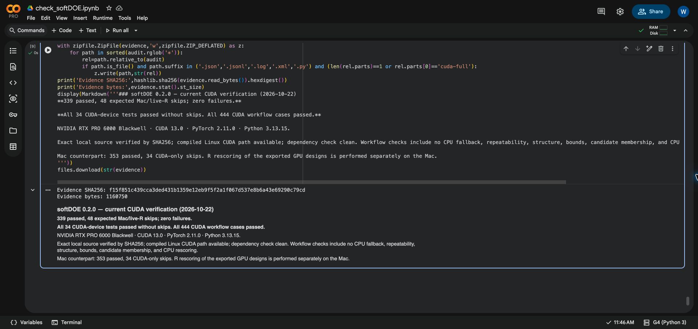

# softDOE 0.2.0: macOS and Google Colab CUDA verification

Verified on 2026-10-22. **All 387 existing pytest items passed on at least one
applicable platform, with no failures. All 34 real-device CUDA items ran and
passed on Colab.** The additional full CUDA workflow matrix passed 444/444
cases, and independent R rescoring passed for all 429 valid GPU-produced designs.

This validates the current local package inputs, not merely the older public Git
commit or the October 2 Colab results. No package implementation, test assertion,
fixture, numerical tolerance, or R installation was changed.

## Executed checks

| Check | Passed | Skipped | Failed |
| --- | ---: | ---: | ---: |
| Apple M4 macOS, Python 3.14.7, PyTorch, Metal, live MOFAT 2.0 | 353 | 34 CUDA-only | 0 |
| Colab Linux, Python 3.13.15, CUDA 13.0, NumPy 2.5.4 | 339 | 48 | 0 |
| Colab with compatible NumPy 2.2.6 and clean `pip check` | 339 | 48 | 0 |
| Fresh Mac Python 3.9.6 wheel installation, live R | 334 | 53 optional | 0 |
| Fresh Mac Python 3.9.6 source installation, live R | 334 | 53 optional | 0 |
| Fresh Mac Python 3.14.7 wheel installation, live R | 334 | 53 optional | 0 |
| Fresh Mac Python 3.14.7 source installation, live R | 334 | 53 optional | 0 |
| Full CUDA workflow configurations | 444 | 0 | 0 |
| Independent R CPU rescoring of CUDA designs | 429 | 0 | 0 |

Colab's 48 skips comprise 32 Metal tests, four macOS Accelerate trajectory
fixtures, and 12 optional live-R tests. All 48 pass on the Mac. The 34 Mac skips
all pass on Colab. [Per-test platform results](per-test-platform-results.csv)
and [combined counts](combined-tests.json) establish that the union is exactly
387 tests, with none left untested. Mocked CUDA tie/fallback checks are not counted
among the 34 actual-device items.

All four fresh distribution installations also pass isolated import checks,
`twine check --strict`, required asset checks, `pip check`, the example script,
and README Python examples. Base installations omit optional PyTorch, explaining
their additional skips; native Metal remains available.

## Hardware and source identity

- Mac: Apple M4, native Metal; details in [mac-environment.json](mac-environment.json).
- Colab: NVIDIA RTX PRO 6000 Blackwell Server Edition (94.97 GiB), driver
  580.82.07, CUDA 13.0, PyTorch 2.11.0+cu130, Python 3.13.15, SciPy 1.16.3,
  PyDOE 1.6.0. Final environment: [environment-compatible.log](colab/environment-compatible.log).
- Source archive SHA256:
  `ad8e8781e4a8fd5876f32fdc2c5a7ae8f4f0906d516f314d500fbeab1b3cbfc5`.
- Upload bundle SHA256:
  `3d0799067576caca775beeb8518fdf08f20025118874b04877d1115128873aaa`.
- Downloaded evidence SHA256:
  `f15f851c439cca3ded431b1359e12eb9f5f2a1f067d537e8b6a43e69290c79cd`.

Colab verified the uploaded bundle, all 29 source archive inputs, and all 37
validation files before installation. It compiled a Linux wheel from that exact
sdist and tested the installed package outside the source tree. The CUDA driver,
backend self-test, compiled native entry point, and NVRTC configuration were all
required to be available. Test names and JUnit results were checked explicitly to
reject skipped CUDA cases.

All 29 package inputs also match the October 17 corrected revision; see
[source-comparison.json](source-comparison.json). Its historical 888/888
CPU/Metal comparisons remain relevant, and all 28 historical evidence checksums
were revalidated. Those broad Mac comparisons were not rerun today.

## Additional CUDA workflow checks

[run_cuda_matrix.py](colab/run_cuda_matrix.py) reuses the unchanged repository's
`experiment_cases('full')`, `prepare_cases`, and `run_python_case` helpers.
It runs 105 valid `soft`, 324 valid `a_soft`, and 15 invalid-input configurations.
Every valid workload runs a warmup and one measured repetition, with exact
repeatability, actual CUDA dispatch, and no unexpected CPU fallback required.
Checks cover dimensions, bounds, OFAT structure, supplied-prefix preservation,
candidate membership/uniqueness, QMC counts, and returned scores against Python
CPU evaluation using the existing relative tolerance of `1e-8`.

The actual designs were then downloaded and rescored by unmodified R MOFAT 2.0
on this Mac using `tests/reference_experiments.R score`. All 429 passed; maximum
relative Q error was `2.8441214342104595e-14`, and maximum normalized-Q error was
`1.0895459443866998e-15`. This checks the GPU-produced designs against a separate
implementation. It is not a comparison with R's CUDA optimizer or a claim that
CPU and GPU search trajectories must select identical designs.

Evidence: [444-case summary](colab/cuda-full/summary.json),
[raw workflow records](colab/cuda-full/python-results.jsonl),
[R rescore summary](colab/cuda-full/r-rescore-summary.json).

## Test quality and limits

The suite contains meaningful checks beyond successful execution: independent
kernel solves and analytical scores, frozen R fixtures and live R comparisons,
compiled-versus-tensor CUDA search, underflow normalization, paired CUDA state
updates, real-backend assertions, input rejection, and intentional failure
recovery. The broad matrix prevents tiny Q values from passing merely through a
large absolute tolerance. The reference data and acceptance gates were preserved.

A normal green `pytest` run can still hide unavailable GPUs through skips; the
current CI workflow neither provisions CUDA hardware nor requires its availability.
For future GPU release checks, retain the explicit GPU/NVRTC prerequisites and
zero-CUDA-skip checks used here. Current evidence is for this Apple M4 and this
Colab Blackwell configuration. Windows, Intel Mac, other GPU/driver combinations,
R CUDA optimizer parity, and the opt-in 460-case stress profile were not tested
in this audit. A finite test suite cannot prove correctness for every input.

## Setup issues and preserved scope

The first Python 3.9 release attempt lacked the `build` module. Build tools were
installed in `.work/editable-check`; the subsequent complete release run passed.
Colab's latest PyDOE installation upgraded NumPy beyond its preinstalled Numba
constraint; NumPy 2.2.6 satisfies both. A missing IPython dependency, Jedi, was
also installed. The final Colab `pip check` and full suite both pass. These were
environment setup issues, not softDOE test failures. Initial logs are retained.

The source upload was explicitly approved after automatic review requested it.
The browser's file picker and macOS Downloads access required native UI copying;
the downloaded evidence checksum was verified after transfer. An unexpected
computer-control delay affected evidence collection, not the completed test runs.

Inputs: repository `src/softDOE`, `tests`, packaging files, and installed MOFAT 2.0.
Outputs: this directory and `.work/verification-2026-10-22/`.
Changed documentation: `tests/test_README.md`, `docs/verification.md`,
`docs/experiments.md`, `task_plan.md`, and `notes.md`.
Untouched: package source, test code/fixtures, packaging configuration, user `.venv`,
R package, and historical benchmark records. No commit, push, or publication.

The existing [Colab notebook](https://colab.research.google.com/drive/1PeoSvm4QLXx976Qj05izFsEFFL56aWl7)
has the new dated verification cells appended after its older results. Only the
new cells were executed. Reproduction code and complete logs are retained in
[colab/](colab/) and the [downloaded evidence archive](softdoe-verification-2026-10-22-evidence.zip).

